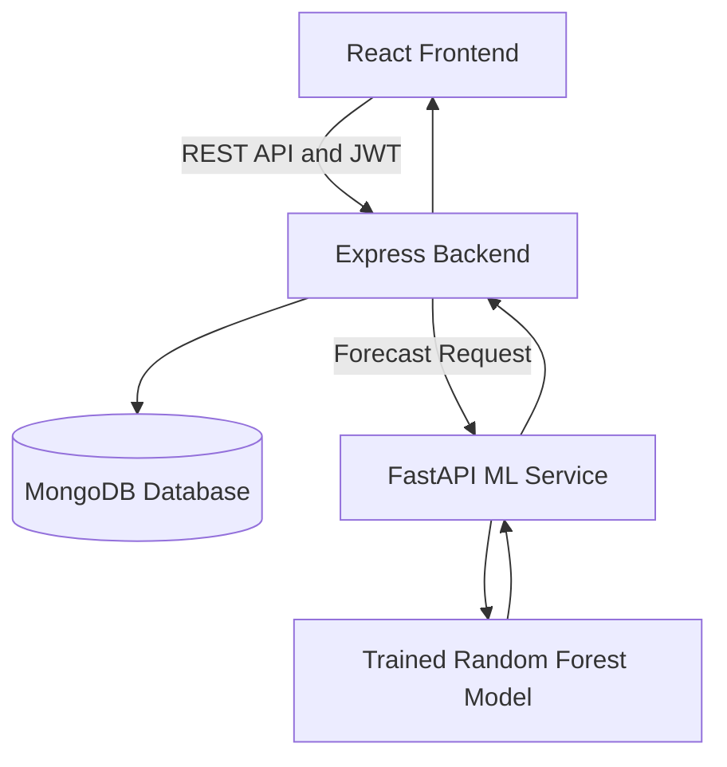

# MarketMind AI
### AI-Powered Local Market Intelligence Platform

MarketMind AI is a full-stack web application designed to help small retailers manage inventory, track sales, analyze business performance, and estimate future product demand using machine learning.

**Academic Project:** BCA Data Science & AI  
**Academic Session:** 2026–2027  
**Institution:** Shri Ramswaroop Memorial University  
**Project Guide:** IBM Faculty

## Project Team

| S. No. | Team Member | Roll Number |
|---|---|---|
| 1 | Ganesh Kumar Verma | 202410101360130 |
| 2 | Abhash Mayank | 202410101360179 |
| 3 | Raj Sharma | 202410101360129 |

## Features

- **User Authentication:** Registration, login, JWT authentication, and protected routes.
- **Inventory Management:** Manage products, stock quantities, and low-stock items.
- **Sales Management:** Record sales and maintain inventory consistency.
- **Business Analytics:** View revenue, gross profit, sales trends, and dashboard summaries.
- **AI Demand Forecasting:** Predict product demand for the next seven days using a trained Random Forest regression model.
- **Market Intelligence:** Generate market comparisons using simulated market-price observations.
- **Demo Data Generation:** Create reproducible synthetic shop, product, and sales data for testing and demonstrations.

> **Data disclaimer:** Demo sales, shops, and market prices are synthetic. Forecasts are estimates and must not be treated as guaranteed demand or real-world market data.

## Technology Stack

| Component | Technologies |
|---|---|
| Frontend | React, Vite, JavaScript, Tailwind CSS |
| Charts and UI | Recharts, Lucide React |
| Backend | Node.js, Express.js |
| Database | MongoDB, Mongoose |
| Authentication | JWT, bcrypt |
| Machine Learning API | Python, FastAPI, Uvicorn |
| Data Processing and ML | pandas, NumPy, scikit-learn |
| Model | Random Forest Regressor |

## System Architecture



The React frontend communicates with the Express backend. The backend handles authentication and business data, while the Python service generates demand forecasts using the trained model.

## Project Structure

```text
MarketMind-AI/
├── client/                 # React frontend
├── server/                 # Express backend and APIs
├── ml-service/
│   ├── app/                # FastAPI application
│   ├── scripts/            # Model training scripts
│   ├── tests/              # ML tests
│   ├── data/               # Processed datasets
│   └── models/             # Trained model and metrics
├── docs/                   # Project documentation
├── package.json            # Root scripts
├── .gitignore
└── README.md
```

## Prerequisites

Install the following before running the application:

- Node.js and npm
- Python 3.11 or later
- MongoDB running locally or a MongoDB Atlas connection
- Git

## Installation and Setup

### 1. Clone the repository

```bash
git clone <YOUR_GITHUB_REPOSITORY_URL>
cd MarketMind-AI
```

Replace the placeholder with the actual repository URL.

### 2. Configure the backend

```powershell
cd server
npm install
Copy-Item .env.example .env
```

Configure `server/.env` with your MongoDB connection string and a secure JWT secret. Do not commit environment files or secrets.

### 3. Configure the frontend

Open a separate terminal from the project root:

```powershell
cd client
npm install
Copy-Item .env.example .env
```

Configure the frontend API URL according to the variable name in `client/.env.example`.

### 4. Set up Python dependencies

From the project root:

```powershell
.\.venv\Scripts\Activate.ps1
python -m pip install -r ml-service/requirements.txt
```

If the root virtual environment has not been created yet:

```powershell
python -m venv .venv
.\.venv\Scripts\Activate.ps1
python -m pip install -r ml-service/requirements.txt
```

### 5. Start the application

Start MongoDB first. Then open three terminals from the project root.

**Terminal 1 — Backend**

```powershell
npm run dev:server
```

**Terminal 2 — Frontend**

```powershell
npm run dev:client
```

**Terminal 3 — ML service**

```powershell
.\.venv\Scripts\python.exe -m uvicorn ml-service.app.main:app --reload --port 8000
```

Open the frontend URL displayed by Vite, usually `http://localhost:5173`.

The Express API normally runs on port `5000`, and the ML service runs on port `8000`. Ensure the backend's ML service URL points to the running Python service.

## Demo Data

To generate reproducible demo data, first start MongoDB and the Express backend, then register an account in the application.

From the project root, run:

```powershell
npm.cmd run seed:demo -- --seed 42 --demo-email your-email@example.com
```

Replace the email with the account you registered. The seed process generates synthetic shop, product, sales, and market-price records.

To reset and regenerate records belonging to the same seed:

```powershell
npm.cmd run seed:demo:reset -- --seed 42 --demo-email your-email@example.com
```

**Caution:** Use the reset command only when you intend to replace the demo records associated with that seed. Do not drop the entire database.

## Machine Learning Workflow

The demand forecasting workflow consists of:

1. Generate synthetic sales history.
2. Export daily product demand into a CSV dataset.
3. Train the Random Forest regression model.
4. Save the trained model and evaluation metrics.
5. Start the FastAPI service.
6. Request a product forecast through the Express backend.
7. Display predicted daily demand on the dashboard.

Export the dataset from the project root:

```powershell
npm.cmd run export:ml-data -- --seed 42
```

The processed dataset is saved at:

`ml-service/data/processed/product-daily-demand.csv`

The trained model is stored at:

`ml-service/models/demand_model.joblib`

The model evaluation metrics are stored at:

`ml-service/models/metrics.json`

### Model Evaluation

The recorded evaluation results are:

| Metric | Result |
|---|---:|
| Model | Random Forest Regressor |
| Training rows | 85,600 |
| Testing rows | 11,200 |
| Test period | 28 days |
| Mean Absolute Error (MAE) | 0.348 |
| Root Mean Squared Error (RMSE) | 0.674 |

These metrics come from the current synthetic dataset and its evaluation split. They do not establish accuracy on real retailer data.

## Forecast API

The Express backend exposes an authenticated forecast endpoint:

```http
GET /api/forecasts/:productId?days=7
```

The endpoint forwards the product ID and requested forecast horizon to the Python ML service and returns the forecast response.

The Python service provides:

- `GET /health` — health check
- `POST /predict` — product demand prediction

The prediction request accepts a product ID and a forecast horizon between 1 and 30 days.

## Testing

Run backend tests:

```powershell
npm run test:server
```

Run frontend tests:

```powershell
npm test --prefix client
```

Build the frontend:

```powershell
npm run build --prefix client
```

Run ML-service tests:

```powershell
.\.venv\Scripts\python.exe -m pytest ml-service/tests -q
```

Run the tests after installing the required dependencies and review the actual output before reporting final test results.

## Limitations

- The demonstration dataset is synthetic and may not represent real retail demand.
- Forecast quality depends on the generated data and the trained model.
- Market comparisons use simulated prices rather than verified live market prices.
- Running the complete application locally requires MongoDB, the Express backend, the React frontend, and the Python ML service.
- Deployment requires separate configuration for the frontend, backend, database, and ML service.

## Future Scope

- Integration with verified live market-price sources.
- Improved forecasting with real historical sales data.
- Notifications for low inventory and predicted stock shortages.
- More advanced business recommendations.
- Cloud deployment and production monitoring.

## Academic Use

MarketMind AI is developed as an academic project to demonstrate full-stack development, database management, API integration, data processing, and machine learning-based demand forecasting.
