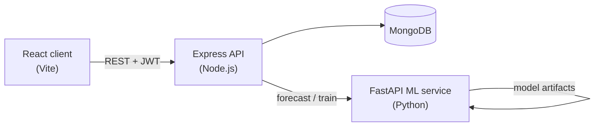

# MarketMind AI

AI-powered local market intelligence platform for small retailers. Academic project for a 3-member BCA Data Science & AI team.

**Current status:** Phases 1–5 are implemented: Express authentication/business APIs, a React frontend, and deterministic synthetic shop, sales, market-comparison, and ML-training data generation. The ML forecasting service and advisor are not implemented yet.

All sales, inventory, market prices, and forecasts in the demo use **synthetic/demo data**. They do not represent real local market conditions.

## Objectives

Help a shop owner:

- Track products and inventory
- Record sales and keep stock consistent
- View revenue, gross profit, and trends from real database records
- Forecast next-week product demand with a trained scikit-learn model
- Compare prices using a clearly labeled simulated market dataset
- Ask a rule-based business advisor grounded in the user's own shop data

## Main features (planned)

| Area | Capability |
| --- | --- |
| Accounts | Register, login, JWT auth, shop profile, per-user data isolation |
| Inventory | CRUD products, stock alerts, inventory value |
| Sales | Multi-item sales, stock checks, refunds/cancellations |
| Analytics | Date-filtered dashboard and charts from the API |
| Forecasting | 7-day demand forecast via Python ML service |
| Market intel | Simulated cross-shop price comparison |
| Advisor | Rule-based answers from analytics (optional LLM later, not required) |

## Technology stack

- **Frontend:** React (Vite), JavaScript, Tailwind CSS, React Router, Axios, Recharts, Lucide React, React Hook Form
- **Backend:** Node.js, Express, MongoDB, Mongoose, JWT, bcrypt, express-validator
- **ML:** Python, FastAPI, pandas, NumPy, scikit-learn
- **Local/free hosting targets:** Vercel (frontend), Render (API and ML), MongoDB Atlas (database)

No paid AI API is required for local development or the academic demo.

## Architecture



- The browser talks only to the Express API (`VITE_API_URL`).
- Express owns authentication, shop data, analytics, market intel, and the advisor.
- The Python service owns training, evaluation, and 7-day forecasts.
- Simulated public market data is stored separately from private shop records.

## Folder structure

```text
MarketMind-AI/
  client/                 React frontend
  server/                 Express backend
  ml-service/             Python forecasting service
  docs/                   Academic and architecture docs
  package.json            Convenience scripts
  README.md
  .gitignore
```

Intended layout after later phases:

```text
server/src/               routes, controllers, models, middleware, services
server/scripts/           seed and demo-account helpers
server/tests/
client/src/               pages, components, api, hooks
ml-service/app/           FastAPI app and forecast pipeline
ml-service/tests/
```

## Prerequisites

- Node.js 20 or later (this machine has 22.16.0)
- npm 10 or later
- Python 3.11+ (this machine has 3.13.2)
- MongoDB locally **or** a free MongoDB Atlas cluster
- Git

## Environment variables

Copy each example file, then edit values. Do not commit `.env` files.

```text
server/.env.example   →  server/.env
client/.env.example   →  client/.env
ml-service/.env.example → ml-service/.env
```

Secrets (`JWT_SECRET`, `MONGODB_URI`, optional `ML_SERVICE_KEY`) belong only in backend / ML `.env` files. Frontend env vars must not contain secrets.

## Installation

```bash
# Express API (Phases 2–3)
cd server
npm install
copy .env.example .env
```

Edit `server/.env`: set `MONGODB_URI` and a long random `JWT_SECRET` (at least 16 characters).

The client is available from Phase 4. The Phase 5 demand-data exporter requires Python and pandas; install the Python dependencies before exporting:

```powershell
cd ..
python -m venv ml-service/.venv
.\ml-service\.venv\Scripts\Activate.ps1
python -m pip install -r ml-service/requirements.txt
```

The ML forecasting service itself is planned for a later phase.

## Run the Express server (Phases 2–3)

MongoDB must be reachable at `MONGODB_URI`. If the database is down, the process prints a clear error and exits.

```bash
cd server
npm run dev
```

Or from the repository root: `npm run dev:server`

Verify:

- `GET http://localhost:5000/api/health` returns `200` with `"database": { "connected": true }` when MongoDB is up
- `POST /api/auth/register` creates a user and returns a JWT
- `POST /api/auth/login` returns a JWT
- `GET /api/auth/me` with `Authorization: Bearer <token>` returns the user (no password)

Authenticated `/api/products`, `/api/sales`, and `/api/analytics/dashboard` endpoints provide the Phase 3 business API. The client is available in `client/`; configure `client/.env` from `.env.example`, run `npm install` in `client`, and start it with `npm run dev`. MongoDB and the Express API must be running for authenticated business features.

## Synthetic demo data and ML dataset

Synthetic MongoDB data is generated only by the local seed script; no demo login or password is published. It creates 10 synthetic shops, 40 products per shop, 270 days of sale history, and a separate synthetic market-price collection. Sales use the existing product/sale schemas and completed-sale analytics rules.

1. Start MongoDB and the Express API using `server/.env` as described above.
2. For a dashboard with data, register your own local account at `http://localhost:5173/register`.
3. From the repository root, attach generated shop data to that account:

```powershell
npm.cmd run seed:demo -- --seed 42 --demo-email your-email@example.com
```

The requested account must already exist. The seed creates the other simulated shop accounts with cryptographically random passwords and never prints or exports those credentials. Without `--demo-email`, all shops are generated as inaccessible synthetic accounts.

Seed generation refuses to overwrite an existing seed. Reset and regenerate **only records tracked by that seed** with:

```powershell
npm.cmd run seed:demo:reset -- --seed 42 --demo-email your-email@example.com
```

For reproducible date windows, set `DEMO_END_DATE=YYYY-MM-DD` in `server/.env`. The default end date is the most recent complete UTC day. `DEMO_HISTORY_DAYS` may be set from 180 to 365 (default 270). `DEMO_SEED` defaults to 42; `--seed` selects a run. Never reset by dropping the database: reset is scoped to exact generated record IDs, preserves the linked account and any other user data, and removes only that seed's separate synthetic market observations.

Export the product-level daily demand CSV after seeding. Python 3.11+ with pandas (already in `ml-service/requirements.txt`) is required; set `PYTHON_EXECUTABLE` if `python` does not select that environment:

```powershell
npm.cmd run export:ml-data -- --seed 42
```

The file is written to `ml-service/data/processed/product-daily-demand.csv` (git-ignored). It contains one row per seeded product per history day, including zero-sales days. Cancelled sales are excluded, and no user emails, shop addresses, or passwords are exported. This is a data-export utility only; no forecasting model or ML service is started.

Run the Phase 5 server and dataset-export tests:

```powershell
npm run test:server
python -m pytest ml-service/tests -q
```

## Tests

Backend tests use an in-memory MongoDB (`mongodb-memory-server`). A live MongoDB install is not required for `npm test`.

```bash
cd server
npm test
```

Or from the repository root: `npm run test:server`

Client tests run with `npm test --prefix client`; the build runs with `npm run build --prefix client`. The pandas dataset-export tests run with `python -m pytest ml-service/tests -q`.

## Deployment (free tiers)

Documented in `docs/` after the app is working locally. Expected mapping:

- Frontend → Vercel
- Express → Render
- ML service → Render (if the free instance is sufficient; otherwise run ML locally)
- Database → MongoDB Atlas

Free-tier cold starts and sleep timeouts will be documented honestly. Local development does not require paid services.

## Documentation

| File | Purpose |
| --- | --- |
| [docs/development-plan.md](docs/development-plan.md) | Phased implementation plan |
| [docs/api-documentation.md](docs/api-documentation.md) | Express API endpoints and request/response behavior |
| docs/problem-statement.md | Academic problem statement (Phase 8) |
| docs/system-architecture.md | Architecture (expanded later) |
| docs/database-design.md | Collections and relationships |
| docs/ml-methodology.md | Forecast model, viva notes |
| docs/testing-report.md | Test results (not fabricated) |
| docs/future-scope.md | Optional LLM and real market data |

## Known limitations (through Phase 5)

- Forecasting, market-intelligence API/UI, and advisor are not built yet. The seed generator creates synthetic market-price records only; it does not claim to use live market data.
- The server will not start without a reachable MongoDB (`MONGODB_URI`).
- Backend tests use MongoDB Memory Server; the first run may download a MongoDB binary.
- Client tests cover display formatting and public/protected route behavior. Synthetic market prices are stored separately but have no market-comparison API yet.
- For a usable local demo, register an account, then seed against it with `--demo-email`; generated synthetic shop credentials are not exposed.
- Multi-document stock updates use MongoDB transactions when available and compensating updates on standalone MongoDB.

## Academic honesty notes

- Demo metrics are computed from generated or user-entered records.
- Market intelligence is labeled simulated until real verified data exists.
- Gross profit is revenue minus cost of goods sold. Net profit is not claimed unless operating expenses are recorded.
- Forecasts are estimates with documented limitations, not guaranteed demand.
