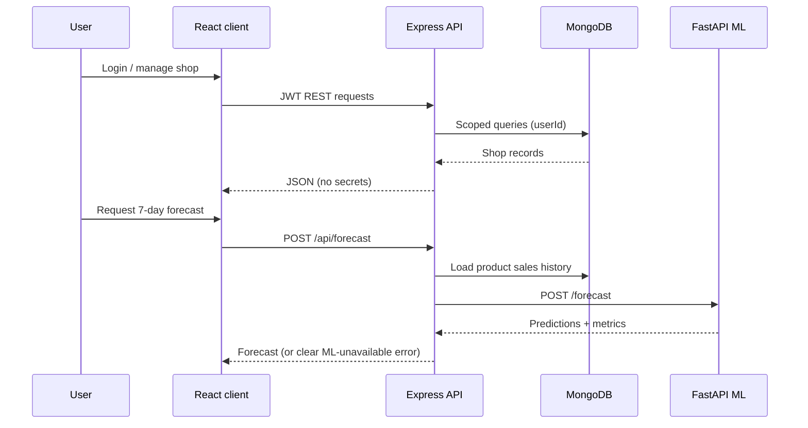

# System architecture (Phase 1 outline)

This file will be expanded after the services exist. The intended design is below.

## Components

| Component | Role |
| --- | --- |
| React client | Landing, auth, dashboard, inventory, sales, analytics, forecast UI, market intel, advisor |
| Express API | Auth, CRUD, aggregations, advisor rules, proxy to ML |
| MongoDB | Users, shops, products, sales, synthetic market catalog |
| FastAPI ML | Train, evaluate, 7-day demand forecast |

## Data flow

## Isolation

- Private collections always filter by authenticated `userId`.
- Market intelligence reads a separate synthetic catalog (`MarketProduct` / equivalent), never another user's sales.

## Failure handling

- If MongoDB is down, the API returns a controlled 503, not a stack trace in production.
- If the ML service is down, forecast endpoints return a clear error. The UI must not invent numbers.
